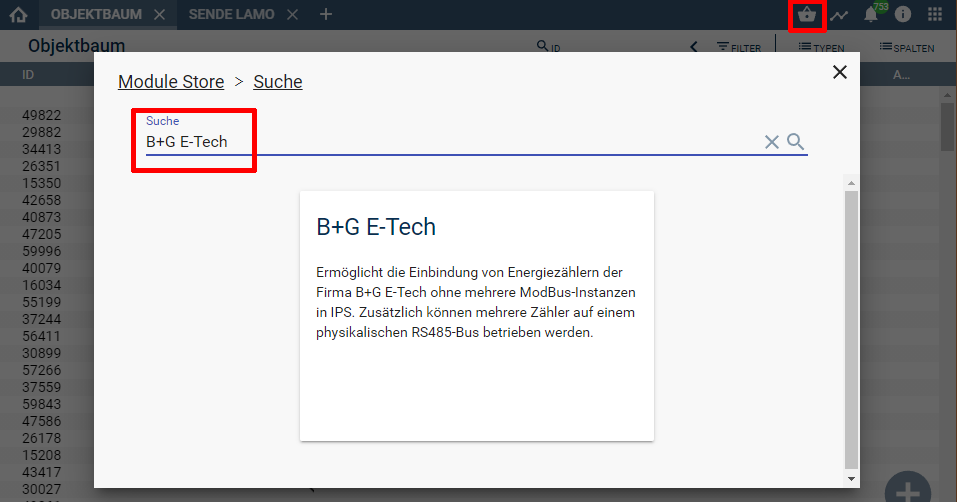

  

  
   

# Symcon-Modul: B+G E-Tech <!-- omit in toc -->  

## Inhaltsverzeichnis <!-- omit in toc -->

- [1. Funktionsumfang](#1-funktionsumfang)
- [2. Voraussetzungen](#2-voraussetzungen)
- [3. Software-Installation](#3-software-installation)
- [4. Einrichten der Instanzen in IP-Symcon](#4-einrichten-der-instanzen-in-ip-symcon)
- [5. Anhang](#5-anhang)
  - [1. GUID der Module](#1-guid-der-module)
  - [2. Changelog](#2-changelog)
  - [3. Spenden](#3-spenden)
- [6. Lizenz](#6-lizenz)

## 1. Funktionsumfang

Ermöglicht die Einbindung von Energie-Zählern der Firma B+G E-Tech
ohne mehrere ModBus-Instanzen in IPS.  
Zusätzlich können mehrere Zähler auf einem physikalischen RS485-Bus
betrieben werden.  

> [!NOTE]
> Die Zähler-Module sind ab Version 4.0 im Wartungsmodus: Sie erhalten nur noch Fehlerbehebungen, aber keine neuen Funktionen oder Zähler.  
> Symcon kann inzwischen selbst mehrere Register in einer Instanz (`ModBus Gerät`) abfragen, auch als Datenblock. Für neue Installationen ist diese Instanz mit einer [Vorlage](templates/) die bessere Wahl. Für alle Zähler dieser Library gibt es eine Vorlage, teils noch ungeprüft.  
> Weiterhin gepflegt wird die RS485 Bus Zeitsteuerung. Sie wird für mehrere Zähler an einem RS485-Bus benötigt, auch mit den Symcon-Instanzen.

Folgende Module beinhaltet die B+G E-Tech Library:

- **RS485BusTiming**  
  [RS485 Bus Zeitsteuerung](RS485BusTiming/README.md): Lässt mehrere ModBus Gateways nacheinander und mit Pause auf einen gemeinsamen RS485-Bus zugreifen  

- **DRS210C**  
  Zähler vom Typ DRS 210-C  

- **SDM120MODBUS**  
  Zähler vom Typ SDM 120-ModBus  

- **DRS458**  
  Zähler vom Typ DRS 458  

- **DRT428M**  
  Zähler vom Typ DRT 428M  

- **DRT710M**  
  Zähler vom Typ DRT 710M  

- **SDM72D**  
  Zähler vom Typ SDM 72D

- **SDM72DMV2**  
  Zähler vom Typ SDM 72DM-V2  
  
- **SDM120C**  
  Zähler vom Typ SDM 120C

- **SDM220**  
  Zähler vom Typ SDM 220  

- **SDM230**  
  Zähler vom Typ SDM 230  

- **SDM530**  
  Zähler vom Typ SDM 530  

- **SDM630**  
  Zähler vom Typ SDM 630

- **SmartX965C**  
  Zähler vom Typ Smart X96-5C/I/J  

## 2. Voraussetzungen

- Symcon 9.0 oder höher  
- Unterstützte Zähler  
- physikalisches RS485 Interface für die Zähler  

## 3. Software-Installation

  Über den 'Module-Store' in IPS das Modul 'B+G E-Tech' hinzufügen.  
  

## 4. Einrichten der Instanzen in IP-Symcon

Ist direkt in der Dokumentation der jeweiligen Module beschrieben:  

- **[RS485 Bus Zeitsteuerung](RS485BusTiming/README.md#4-einrichten-der-instanzen-in-ip-symcon)**
- **[DRS 210-C](DRS210C/README.md#4-einrichten-der-instanzen-in-ip-symcon)**
- **[SDM 120-ModBus](SDM120MODBUS/README.md#4-einrichten-der-instanzen-in-ip-symcon)**
- **[DRS 458](DRS458/README.md#4-einrichten-der-instanzen-in-ip-symcon)**
- **[DRT 428M](DRT428M/README.md#4-einrichten-der-instanzen-in-ip-symcon)**
- **[DRT 710M](DRT710M/README.md#4-einrichten-der-instanzen-in-ip-symcon)**
- **[SDM 72D](SDM72D/README.md#4-einrichten-der-instanzen-in-ip-symcon)**
- **[SDM 72DM-V2](SDM72DMV2/README.md#4-einrichten-der-instanzen-in-ip-symcon)**
- **[SDM 120C](SDM120C/README.md#4-einrichten-der-instanzen-in-ip-symcon)**
- **[SDM 220](SDM220/README.md#4-einrichten-der-instanzen-in-ip-symcon)**
- **[SDM 230](SDM230/README.md#4-einrichten-der-instanzen-in-ip-symcon)**
- **[SDM 530](SDM530/README.md#4-einrichten-der-instanzen-in-ip-symcon)**
- **[SDM 630](SDM630/README.md#4-einrichten-der-instanzen-in-ip-symcon)**
- **[Smart X96-5C/I/J](SmartX965C/README.md#4-einrichten-der-instanzen-in-ip-symcon)**

## 5. Anhang

### 1. GUID der Module

|          Modul          |   Typ    |    Prefix    |                  GUID                  |
| :---------------------: | :------: | :----------: | :------------------------------------: |
| RS485 Bus Zeitsteuerung | Splitter |   RS485BT    | {FF43CA30-41BC-4D29-9B31-EA60B99BCFB3} |
|        DRS 210-C        |  Device  |   DRS210C    | {2CA41C9F-355C-4231-90A5-6D83A90B65BD} |
|     SDM 120-ModBus      |  Device  | SDM120MODBUS | {007A55EC-C9C4-4241-8F39-2F0CA809F54D} |
|         DRS 458         |  Device  |    DRS458    | {8CA96C98-3014-44E4-8D15-4EC6B524F1F4} |
|        DRT 428M         |  Device  |   DRT428M    | {7EE791EF-574D-4B52-84D7-331CFDF0C512} |
|        DRT 710M         |  Device  |   DRT710M    | {187BB86B-A52F-4ADD-A233-92108BD71767} |
|         SDM 72D         |  Device  |    SDM72D    | {08371372-5993-4BAF-A6EC-D70759709CD9} |
|       SDM 72DM-V2       |  Device  |  SDM72DMV2   | {A4320883-E4EE-4F01-B0CC-B1DDF3E73ACA} |
|        SDM 120C         |  Device  |   SDM120C    | {32DCCC5C-78D3-475E-885A-652F56DB4D18} |
|         SDM 220         |  Device  |    SDM220    | {93668601-F92A-46FC-AE5B-E44451F022EE} |
|         SDM 230         |  Device  |    SDM230    | {10D08FCD-D1AC-4CF3-8B19-54B92209DA07} |
|         SDM 530         |  Device  |    SDM530    | {9A65E88A-21DC-439F-8602-CA14EE9FDF27} |
|         SDM 630         |  Device  |    SDM630    | {BBCA5E14-505E-4394-B653-8CD33AD52037} |
|    Smart X96-5C/I/J     |  Device  |    X965C     | {E151A4EC-51E8-4066-9FC3-D724E846D3B2} |

### 2. Changelog

**Version 4.00:**  

> [!IMPORTANT]
>
> - Benötigt Symcon 9.0 oder höher.
> - Die Zähler-Module sind im Wartungsmodus und erhalten nur noch Fehlerbehebungen. Für neue Installationen wird die Symcon-Instanz `ModBus Gerät` mit einer [Vorlage](templates/) empfohlen (Übersicht und Prüfstand in der [Vorlagen-README](templates/README.md)).
> - Bestehende Instanzen übernehmen beim Update korrigierte Registeradressen. Namen, Reihenfolge und Aktiv-Status der Variablen bleiben erhalten.
> - SDM 530, SDM 630, Smart X96-5C/I/J: Leistungsfaktor (Register 0x003E) und Leistungsfaktor-Winkel (0x00FE) teilten sich bisher eine Variable. Die bestehende Variable zeigt jetzt den Leistungsfaktor, der Winkel erhält eine neue Variable.
> - SDM 530, SDM 630: Die Variablen `Blindleistung seit letzten Reset` und `Wirkleistung seit letzten Reset` werden nicht mehr aktualisiert und können gelöscht werden. Ihre Werte stehen jetzt richtig bezeichnet in `Scheinenergie seit letztem Reset` (kVAh) und `Ladungsmenge seit letztem Reset` (Ah).

**Neue Module**  

- [RS485 Bus Zeitsteuerung](RS485BusTiming/README.md): Lässt mehrere ModBus Gateways nacheinander und mit einstellbarer Pause auf einen gemeinsamen RS485-Bus zugreifen  
- [Vorlagen](templates/README.md) für alle Zähler zur Nutzung mit der Symcon-Instanz `ModBus Gerät`, mit Datenblöcken wo möglich sowie Geräte-ID, Baudrate und Parität zum Einstellen  
- [Vorlagen](templates/README.md) für WS100-19xx, SDM630MCT, SDM54, SDM72CT, SDM18, SDM630-TCP (auch SDM630MCT-ML-TCP), Smart X96-5A, DCM230 und DCM232 (ohne eigenes Zähler-Modul)  

**Neue Statusvariablen**  

- SDM 530, SDM 630, Smart X96-5C/I/J: Gesamt Leistungsfaktor Winkel  
- SDM 530, SDM 630: Scheinenergie seit letztem Reset, Ladungsmenge seit letztem Reset  

**Geändertes Verhalten**  

- Kennt ein Zähler ein Register nicht, werden die übrigen Werte trotzdem gelesen (bisher brach die Abfrage ab)  
- Beim Anlegen einer Zähler-Instanz schlägt die Konsole ein ModBus Gateway als übergeordnete Instanz vor  
- Neue Instanzen: Energiewerte heißen Wirkenergie, Blindenergie und Scheinenergie statt Wirk-, Blind- und Scheinleistung (siehe Tabelle)  

Betroffen sind nur Zählerstände (kWh, kVArh, kVAh). Sie messen Energie, nicht Leistung; die Messgeräterichtlinie 2014/32/EU (Anhang V, MI-003) spricht von „elektrischer Wirkenergie“. Momentanwerte (W, VAr, VA) heißen weiterhin Wirk-, Blind- und Scheinleistung.  
Bestehende Variablen behalten ihren bisherigen Namen und können bei Bedarf selbst umbenannt werden. Dabei entfällt `kumulierte`, und bei den Zählerständen wird aus `Wirkleistung`, `Blindleistung`, `Scheinleistung` jeweils `Wirkenergie`, `Blindenergie`, `Scheinenergie`. Zusätze wie `L1` bis `L3` oder `(rückstellbar)` bleiben erhalten (z.B. `L1 Gesamte kumulierte Wirkleistung` → `L1 Gesamte Wirkenergie`).

| Bisheriger Name                       | Neuer Name                          | Zähler                                                                                      |
| :------------------------------------ | :---------------------------------- | :------------------------------------------------------------------------------------------ |
| Gesamte kumulierte Wirkleistung       | Gesamte Wirkenergie                 | alle außer DRT 710M                                                                         |
| aufgenommene kumulierte Wirkleistung  | aufgenommene Wirkenergie            | alle außer DRS 458 und DRT 710M                                                             |
| abgegebene kumulierte Wirkleistung    | abgegebene Wirkenergie              | alle außer DRS 458 und DRT 710M                                                             |
| Gesamte kumulierte Blindleistung      | Gesamte Blindenergie                | DRT 428M, SDM 120-ModBus, SDM 220, SDM 230, SDM 530, SDM 630, SDM 72DM-V2, Smart X96-5C/I/J |
| aufgenommene kumulierte Blindleistung | aufgenommene Blindenergie           | DRT 428M, SDM 120-ModBus, SDM 220, SDM 230, SDM 530, SDM 630, Smart X96-5C/I/J              |
| abgegebene kumulierte Blindleistung   | abgegebene Blindenergie             | DRT 428M, SDM 120-ModBus, SDM 220, SDM 230, SDM 530, SDM 630, Smart X96-5C/I/J              |
| Wirkleistung Tarif 1 / Tarif 2        | Wirkenergie Tarif 1 / Tarif 2       | DRS 210-C                                                                                   |
| Gesamte Import / Export Wirkleistung  | Gesamte Import / Export Wirkenergie | DRT 710M                                                                                    |
| Gesamte Wirkleistung                  | Gesamte Wirkenergie                 | Smart X96-5C/I/J                                                                            |
| Gesamte Scheinleistung                | Gesamte Scheinenergie               | Smart X96-5C/I/J                                                                            |
| Netto-Wirkleistung                    | Netto-Wirkenergie                   | SDM 72DM-V2                                                                                 |

**Behobene falsche Werte in Statusvariablen**  

- DRS 210-C: `Aktueller Tarif` wurde nie gelesen, und die Abfrage brach an dieser Stelle ab, sodass auch die Energiewerte danach fehlten  
- SDM 630: `L3 total active energy` wurde bei Instanzen, die vor Version 3.10 angelegt wurden, weiterhin aus einem falschen Register gelesen  
- SDM 530, SDM 630: Die Register 0x0050 und 0x0052 hatten falsche Bezeichnungen und die Einheit kWh statt kVAh bzw. Ah  

**Version 3.51:**  

- DRT 428M Powerfaktor L3 war defekt  
- DRT 428M Profile für Wirkleistung korrigiert  

**Version 3.50:**  

- Smart X96-5C/I/J ergänzt  
- Fehlende Übersetzungen ergänzt  
  
**Version 3.40:**  

- SDM 120-ModBus ergänzt  
- DRT 428M ergänzt  
- SDM 72DM-V2 ergänzt
- Aktuelle und Summen für Import und Export ergänzt für SDM230
- Rücksetzbare Zähler vom SDM230, SDM530 und SDM630 ergänzt
- Dokumentation SDM72D ergänzt
- Tarifzähler DRS210C ergänzt

**Version 3.30:**  

- Import und Export Werte für SDM120C, SDM220, SDM230, SDM530 und SDM630 ergänzt

**Version 3.23:**  

- Schreibfehler korrigiert  
- Neue Tests  
- Neues Style  

**Version 3.10:**  

- Fehler bei SDM360 L3 total active energy behoben  

**Version 3.01:**  

- Falsche Bezeichnung des SDM210C zu SDM120C umbenannt  

**Version 3.0:**  

- Release für IPS 5.1 und den Module-Store  

**Version 2.06:**  

- IntervallBox und caption ersetzt  

**Version 2.05:**  

- Bugfix für DRT 710M  

**Version 2.04:**  

- DRT 710M ergänzt  

**Version 2.03:**  

- SDM 530 ergänzt  

**Version 2.2:**  

- Intern werden jetzt auch Integer, Boolean und String Variablen unterstützt  
- Fehlende Übersetzungen ergänzt  

**Version 2.1:**  

- Abzufragende Werte können deaktiviert werden  

**Version 2.0:**  

- DRS 458 ergänzt  
- SDM 72D ergänzt  
- SDM 120C ergänzt  
- SDM 220 ergänzt  
- SDM 230 ergänzt  
- SDM 630 fehlende Werte ergänzt und kleiner Bugfixes  

**Version 1.1:**  

- Profile ergänzt  
- Doku ergänzt  

**Version 1.0:**  

- Erstes offizielles Release  

### 3. Spenden  
  
  Die Library ist für die nicht kommerzielle Nutzung kostenlos, Schenkungen als Unterstützung für den Autor werden hier akzeptiert:  

  

  

## 6. Lizenz

  IPS-Modul:  
  [Custom NC-SA](LICENSE)  
